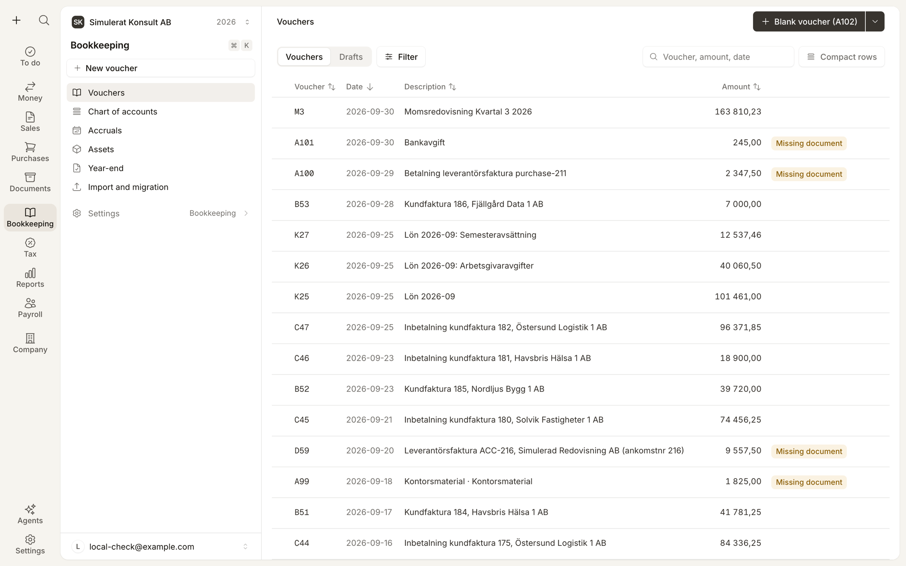

<p align="center">
  
</p>

<h1 align="center">Accounted</h1>

Open-source Swedish accounting software for sole traders (enskild firma) and limited companies (aktiebolag). Double-entry bookkeeping that complies with Swedish accounting law, built to be operated by you or by your AI agent.

[](LICENSE) [](https://github.com/erp-mafia/accounted/actions/workflows/docker-publish.yml)

[Use Accounted](https://app.accounted.se) · [Self-host](docs/SELF-HOSTING.md) · [Documentation](docs/README.md) · [What's new](https://github.com/erp-mafia/accounted/releases) · [Contribute](.github/CONTRIBUTING.md)

<p align="center">
  
</p>

## Why Accounted?

**Compliant by construction.** Accounted implements double-entry bookkeeping under Swedish accounting law (Bokföringslagen). Voucher immutability, sequential voucher numbering, period locks, and 7-year document retention are enforced by database triggers, not by convention. See the [architecture guide](docs/architecture.md) for the engine, enforcement, and audited correction paths.

**Agent-native.** The full bookkeeping engine is exposed as 150+ MCP (Model Context Protocol) tools with scoped API keys or OAuth, so an AI agent can do the books in Accounted: categorize transactions, draft vouchers, reconcile periods, and prepare declarations. Posting is staged for human approval, so the agent proposes and you decide.

**Yours to run.** AGPL-3.0 licensed and fully self-hostable with Docker and Supabase. Use the hosted version at [app.accounted.se](https://app.accounted.se) or run your own.

## Features

- **Double-entry bookkeeping**: BAS 2026 chart of accounts, draft/commit workflow, sequential voucher numbering
- **Invoicing**: Create, send, and track invoices with mixed VAT rates and PDF generation
- **Bank reconciliation**: PSD2 bank feeds, 4-pass automatic matching
- **VAT declaration**: SKV 4700 form mapping, per-rate breakdown, EU/export handling
- **Tax reports**: NE-bilaga, INK2, SRU export for Skatteverket
- **Payroll**: Salary runs, payslips, and AGI (arbetsgivardeklaration) employer declarations
- **Supplier invoices**: Registration, payment tracking, input VAT deduction
- **Supplier payment files (betalfil)**: Batch supplier payments into ISO 20022 pain.001 files for upload to the bank, rendered byte-identical on every download
- **E-invoicing (Peppol)**: Send and receive Peppol BIS Billing 3 e-invoices through Qvalia, a certified Swedish Access Point; received documents land in the supplier invoice inbox
- **Skattekonto**: Tax account transactions synced from Skatteverket or imported from statement files, linked to the booked 1630 movements for reconciliation
- **Document archive**: SHA-256 integrity, 7-year retention enforcement, full archive ZIP export
- **Inkorg**: One inbox for receipts, supplier invoices and emailed documents; an invoice and its receipt become one purchase, booked in one step
- **Digital mailboxes**: Kivra and Billo: read incoming mail into the Inkorg, send invoices and payslips
- **Document signing**: Send a PDF for signing with BankID; every signature gets a signeringsbevis
- **SIE import/export**: Standard Swedish accounting interchange format
- **Agent access (MCP)**: 150+ bookkeeping tools over the Model Context Protocol, with scoped API keys and staged approvals; connects to Claude, ChatGPT, Grok, Gemini, Microsoft Copilot Studio and Cursor over OAuth 2.1
- **Claude connector and plugin**: Connect Claude.ai or Claude Code over OAuth 2.1 and install approval-gated workflow skills (`/accounted:bookkeep`, `/accounted:vat`, `/accounted:year-end`, ...) from [the Accounted plugin](packages/claude-plugin/README.md); the same plugin installs in Codex and Cursor
- **Command line**: `npm install -g accounted` runs every tool from a terminal, a script or a coding agent's shell, with the same permissions and staged approvals
- **Extension system**: Opt-in plugins for AI document extraction, bank sync, email, calendar, and more

## Agent skills

Accounted's workflows and its Swedish accounting knowledge ship as [Agent Skills](https://agentskills.io): folders with a `SKILL.md` that Claude Code, Codex, Cursor, OpenClaw and other agents load when the task calls for them. There are three sets.

### Bookkeeping flows

The [Accounted plugin](packages/claude-plugin/README.md) bundles the MCP connection with these flows. Each one works from the company's live data and stages every write for your approval. They need an Accounted account, hosted or self-hosted; the sign-in screen creates one.

| Skill | What it does |
| --- | --- |
| `start` | Connect, orient, and surface what needs attention |
| `start-company` | Start a new aktiebolag: interview, documents, verksamt.se, setup after registration |
| `bookkeep` | Clear unbooked bank transactions and receipts |
| `check` | Read-only health check with a prioritized fix list |
| `month-close` | Close the month against the product's checklist |
| `vat` | Prepare and reconcile the momsdeklaration |
| `payroll` | Monthly salary run and AGI underlag |
| `year-end` | Bokslut, readiness-gated |
| `clients` | Every company on the connection in one table; run one task for all of them |

```text
# Claude Code
/plugin marketplace add erp-mafia/accounted
/plugin install accounted@accounted

# Codex, then install "accounted" from the plugin list
codex plugin marketplace add erp-mafia/accounted
```

Cursor and every other MCP client: see the [plugin README](packages/claude-plugin/README.md#install).

### Integration skills

For building against Accounted, or driving it from a shell. They live in [`skills/`](skills/).

| Skill | What it does |
| --- | --- |
| `accounted-api` | Build against the REST API: auth, conventions and every endpoint |
| `accounted-cli` | Work in the books from a shell with the `accounted` command |
| `accounted-gather` | Find and upload the documents the archive says are missing |
| `accounted-start-company` | Start a Swedish aktiebolag: the verksamt.se steps, the board and naming rules, and what to file after registration |
| `openapi-to-skill` | Turn any OpenAPI spec into an agent skill |

```bash
npx skills add erp-mafia/accounted --skill accounted-api
```

Add `-a codex`, `-a cursor`, `-a openclaw` or another agent name to choose where the skill is installed.

### Swedish accounting knowledge

Reference skills on Swedish bookkeeping law, tax and reporting. They are MIT licensed, work without an Accounted account, and are published in [erp-mafia/accounted-skills](https://github.com/erp-mafia/accounted-skills). An agent connected to Accounted loads the current versions with `accounted_load_skill`.

| Skill | Covers |
| --- | --- |
| `swedish-accounting-compliance` | BFL, BFNAR, BAS kontoplan, K2/K3, verifikationer, bokföringsskyldighet |
| `swedish-asset-accounting` | Anläggningsredovisning, planenlig avskrivning and överavskrivning, BAS 10xx-12xx/78xx |
| `swedish-cash-register` | Kassaregister, personalliggare, dagskassor, kassadifferens, dricks, presentkort |
| `swedish-daily-bookkeeping` | Kontering of everyday transactions: payment providers, foreign purchases, skattekonto, owner transactions, receipts |
| `swedish-e-invoicing` | Peppol BIS Billing 3, EN 16931, the B2G mandate, Swedish CIUS rules, ViDA |
| `swedish-ef-skatteplanering` | Enskild firma: räntefördelning, expansionsfond, egenavgifter, NE-bilaga, EF vs AB |
| `swedish-financial-reporting` | Årsredovisning, Bolagsverket filing, INK2/INK2R/INK2S, noter |
| `swedish-inventory` | Varulager: lägsta värdets princip, FIFU, inkurans, inventering |
| `swedish-invoice-compliance` | Mandatory invoice fields (ML 17 kap), kreditfaktura, ROT/RUT, reverse charge |
| `swedish-k3-k4-judgment` | K3 (BFNAR 2012:1) in depth, K4 at a high level, switching from K2 to K3 |
| `swedish-payroll` | AGI, arbetsgivaravgifter, skatteavdrag, förmånsbeskattning, semesterlöneskuld, BAS 7xxx |
| `swedish-project-accounting` | Projektredovisning, pågående arbeten, revenue recognition under K2 and K3, SIE dimensions |
| `swedish-sie-import-export` | SIE4 parsing, validation, generation, encoding |
| `swedish-sru-filing` | SRU files for Skatteverket (INFO.SRU and BLANKETTER.SRU), INK2 field codes |
| `swedish-tax-planning` | Aktiebolag: periodiseringsfond, överavskrivningar, koncernbidrag, 3:12-reglerna |
| `swedish-travel-expenses` | Tjänsteresor: traktamente, milersättning, logi, tremånadersregeln |
| `swedish-vat` | Momsdeklaration rutor, EU VAT, reverse charge, BAS 26xx, ML 2023:200 |
| `swedish-year-end-closing` | Bokslut for AB and enskild firma, closing entries, tax provisions, filing |

```bash
npx skills add erp-mafia/accounted-skills                      # choose from the list
npx skills add erp-mafia/accounted-skills --skill swedish-vat  # one skill
```

## Self-Hosting

```bash
git clone https://github.com/erp-mafia/accounted.git
cd accounted
./docker/setup.sh       # Prompts for Supabase credentials, generates .env
docker compose up -d
```

You need a Supabase project and must apply the database migrations before first use. See [docs/SELF-HOSTING.md](docs/SELF-HOSTING.md) for the full step-by-step guide, including Supabase setup, auth configuration, optional features (AI, email), and troubleshooting. To run everything on Swedish infrastructure (your own Supabase stack, Swedish hosting, AI on Swedish GPUs), see [docs/SOVEREIGN.md](docs/SOVEREIGN.md).

## Development Setup

Prerequisites: Node.js 20 or newer (CI and the hosted app run Node 24; the Docker image ships Node 22), Docker, and the [Supabase CLI](https://supabase.com/docs/guides/local-development). No Supabase account is needed.

```bash
npm install
npm run local:up    # Local Supabase with every migration applied, a user and a company, and the dev server
npm run local:down  # Stop it and delete its data
npm test            # Run tests
npm run build       # Production build
npm run lint        # ESLint
```

`npm run local:up` prints the URL to open and the login to use. A start takes several minutes: it downloads the Supabase images the first time and applies every migration. It will not start in a checkout that has a `.env`, `.env.local` or `.env.development` file, because the dev server would load the keys in them. Add `-- --sim` for a company with three years of example books.

To develop against a Supabase project of your own instead, see the [contributing guide](.github/CONTRIBUTING.md), which also covers the full development workflow.

## Tech Stack

- **Framework**: Next.js 16 (App Router), React 19, TypeScript (strict)
- **Database**: Supabase (PostgreSQL + Row Level Security + email/password auth + TOTP MFA)
- **Styling**: Tailwind CSS 4 + shadcn/ui
- **Integrations**: bank feeds over PSD2 (Enable Banking, or Open Payments through Accounted Connect), Qvalia (Peppol), Skatteverket, Kivra and Billo (digital mailboxes), Anthropic SDK on Amazon Bedrock (eu-north-1; direct Anthropic or any OpenAI-compatible endpoint for self-hosted via the Vercel AI SDK), Resend, JSZip

The Kivra and Billo integrations are Accounted's own code, built on the providers' public developer documentation. They are not official Kivra or Billo products, and neither provider supports them or answers for their security. Running them takes your own agreement and credentials with each provider.

## Repository map

| Path | Purpose |
| --- | --- |
| [`src/`](src/README.md) | Application routes, components, accounting services, translations, and extensions |
| [`packages/`](packages/) | MCP bridges, the `accounted` command-line client, connector contract, and the agent plugin (Claude Code, Codex, Cursor) |
| [`supabase/`](supabase/) | Database configuration and migration history |
| [`tests/`](tests/) | Shared fixtures, database suites, and cross-cutting tests; unit tests also live beside their code |
| [`scripts/`](scripts/README.md), [`docker/`](docker/) | Development tools and self-hosting internals |
| [`docs/`](docs/README.md) | Architecture, hosting, and operations |

[`packs/`](packs/README.md) holds bookkeeping templates, [`registry/`](registry/README.md) holds community content, and [`skills/`](skills/) holds installable agent skills. These are maintained inputs, not generated build folders.

## Documentation

The [documentation index](docs/README.md) groups the repository guides by task.

- [User and API documentation](https://docs.accounted.se)
- [Architecture](docs/architecture.md)
- [Self-hosting](docs/SELF-HOSTING.md) and [Docker reference](docs/DOCKER.md)
- [Extension development](docs/EXTENSIONS.md)
- [Contributing](.github/CONTRIBUTING.md) and [security reporting](.github/SECURITY.md)

## Community

- Found a bug or have an idea? [Open an issue](https://github.com/erp-mafia/accounted/issues/new/choose)
- Security vulnerabilities: see [SECURITY.md](.github/SECURITY.md), never a public issue
- Everyone interacting in the project is expected to follow the [Code of Conduct](.github/CODE_OF_CONDUCT.md)

## Contributing

Contributions are welcome. See [contributing guide](.github/CONTRIBUTING.md) for the full guide.

Your first pull request asks you to accept the [Contributor License Agreement](CLA.md) once; the bot links it.

## License

[AGPL-3.0-or-later](LICENSE). See [NOTICE](NOTICE) for third-party attributions.

```text
gnubok - Swedish bookkeeping software
Copyright (C) 2025-2026 Jakob Wennberg

This program is free software: you can redistribute it and/or modify
it under the terms of the GNU Affero General Public License as published by
the Free Software Foundation, either version 3 of the License, or
(at your option) any later version.

This program is distributed in the hope that it will be useful,
but WITHOUT ANY WARRANTY; without even the implied warranty of
MERCHANTABILITY or FITNESS FOR A PARTICULAR PURPOSE. See the
GNU Affero General Public License for more details.
```

If the AGPL's obligations don't work for you, for example because you want to embed Accounted in a closed product, contact us at [support@accounted.se](mailto:support@accounted.se) for a commercial license from Arcim Technology AB.

The name Accounted and the Accounted logo are trademarks of Arcim Technology AB and are not covered by the AGPL: a modified version you offer to others needs its own name. See [TRADEMARK.md](TRADEMARK.md).
